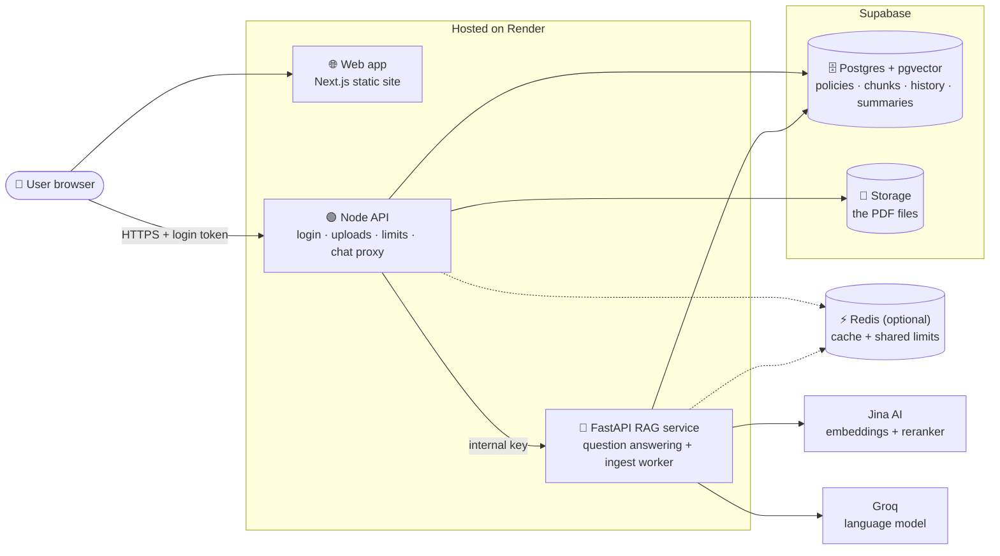
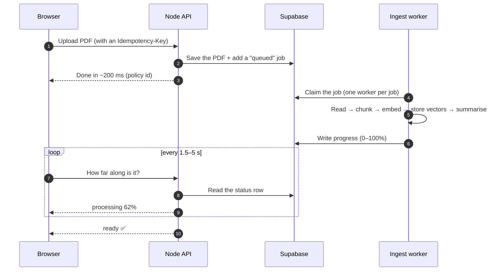
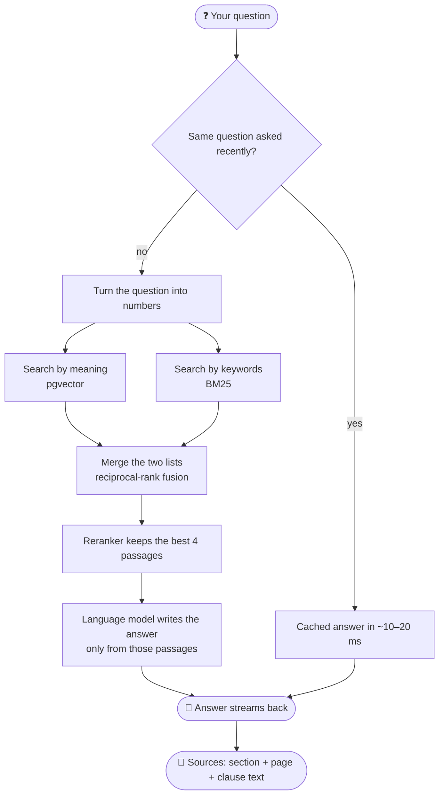

<div align="center">

# PolicyLens

### Complex policies, clear answers.

Upload an insurance or policy PDF, ask questions in plain English, and get answers
backed by **the exact clause and page number**.

[**Live demo**](https://policylens-devj-web.onrender.com/) ·
[Architecture](docs/ARCHITECTURE.md) ·
[RAG quality report](docs/RAG_EVAL.md) ·
[Deploy guide](docs/DEPLOY_RENDER.md)


</div>

---

## Table of contents

1. [What is PolicyLens?](#what-is-policylens)
2. [Demo](#demo)
3. [How it works, in simple words](#how-it-works-in-simple-words)
4. [Architecture](#architecture)
5. [What is built and what is not](#what-is-built-and-what-is-not)
6. [Quality: how we know the answers are good](#quality-how-we-know-the-answers-are-good)
7. [Tech stack](#tech-stack)
8. [Project structure](#project-structure)
9. [Run it on your computer](#run-it-on-your-computer)
10. [Configuration](#configuration)
11. [API overview](#api-overview)
12. [Testing](#testing)
13. [Deployment](#deployment)
14. [Good to know (limits and honest notes)](#good-to-know-limits-and-honest-notes)
15. [More documentation](#more-documentation)

---

## What is PolicyLens?

Insurance and government policy documents are long, full of legal language, and easy to
misread. PolicyLens lets you **ask the document questions** instead of reading it:

> **You:** Is there a waiting period for pre-existing diseases?
> **PolicyLens:** Yes, 36 months of continuous cover. *(Section 4.2, page 12)* — and clicking that
> source opens the PDF at page 12 with the exact clause highlighted.

The important part is the **proof**. Every answer points to the passage it came from, so you can
check it yourself instead of trusting the AI blindly. If the document does not contain the
answer, PolicyLens says so instead of guessing.

**Who is it for?** Anyone who has to understand a policy: policyholders, agents, students and
analysts reading regulatory circulars.

---

## Demo

**Try it live:** <https://policylens-devj-web.onrender.com/>

> The site runs on free hosting. If nobody has used it for about 15 minutes, the first request can take
> **30–60 seconds** while the servers wake up. After that it is fast.

| Light and dark themes | Sign in |
|---|---|
|  |  |

| Ask a question, get a cited answer | Click the source, see the clause |
|---|---|
|  |  |

**Try these in the live app** (sign in with Google or an email, then upload any policy PDF):

1. Upload a PDF and watch the progress ring while it is read and indexed (usually under a minute).
2. Ask *"What is the free look period?"* The answer streams in word by word.
3. Click a source chip such as **p.11**: the PDF jumps to that page and highlights the clause.
4. Open the **Summary** tab for benefits, exclusions and conditions in plain language.
5. Tick **Compare**, pick two or more policies, and ask one question across all of them.
6. Click the sun / moon button to switch between light and dark.

---

## How it works, in simple words

Think of PolicyLens as a very fast librarian with two jobs.

### Job 1 — Reading your document (happens once, when you upload)

1. **Read the PDF.** The text is pulled out page by page, and page headers and footers are removed.
2. **Cut it into pieces ("chunks").** The document is split along its own headings, so a chunk is one
   clause or one table row, and it remembers which section and page it came from.
3. **Turn each piece into numbers ("embeddings").** An AI model converts the *meaning* of each chunk
   into a list of numbers. Chunks with similar meaning get similar numbers.
4. **Store them.** The numbers go into a database that can search by meaning (Postgres + pgvector).
5. **Write a summary.** An AI writes a plain-language summary of the whole policy.

### Job 2 — Answering a question (every time you ask)

1. **Find the right pages.** Your question is turned into numbers too, and the database finds the
   chunks closest in meaning. A second, keyword-style search (BM25) catches exact terms like "36 months"
   or a clause name. The two result lists are merged.
2. **Pick the best few.** A "reranker" model re-reads the candidates and keeps the most relevant ones.
3. **Ask the AI, with the evidence.** Only those passages are given to the language model, with the rule:
   *answer from this text, or say it isn't there.*
4. **Show the proof.** The answer streams back word by word, and the sections and pages used are shown
   as clickable chips.

This pattern is called **RAG** (retrieval-augmented generation): *look things up first, then answer from
what you found*. It is why the AI sticks to your document instead of inventing things.

---

## Architecture

### The big picture



| Part | What it does | Keeps data? |
|---|---|---|
| **Web app** (`frontend/`) | The pages you see: landing, sign-in, workspace with PDF viewer and chat | No |
| **Node API** (`backend/`) | Checks who you are, enforces limits, stores uploads, forwards questions | No (stateless) |
| **RAG service** (`api/` + `rag_engine/`) | Reads PDFs, searches, reranks, asks the AI, streams the answer | No (stateless) |
| **Supabase** | The database (also the job queue) and PDF storage | **Yes** |
| **Redis** | Remembers recent answers and shared rate-limit counters | Temporary only |

Because the Node and Python services keep nothing in memory that matters, you can run more copies of
either to handle more users.

### What happens when you upload a PDF



### What happens when you ask a question



### Why it is built this way

- **The database is the job queue.** Uploading just stores the PDF and adds a "queued" row. Workers pick
  jobs up safely (`FOR UPDATE SKIP LOCKED`), so jobs survive restarts, and a job that crashes is retried
  (3 attempts, then it shows **Failed** with a Retry button).
- **Redis is a bonus, never a requirement.** If it is missing or down, the app is slower but still works.
- **Search is exact per policy.** Each policy's chunks are ranked directly (not through a shared
  approximate index), so one user's data can never crowd out another's results.
- **No big ML libraries in the server.** Embeddings and reranking use hosted APIs, so the service stays
  small (~250 MB) and starts quickly.
- **Polite under load.** When the AI provider is busy, requests wait briefly and then get a friendly
  "try again" with a `Retry-After` hint instead of crashing.

Full details, failure table and capacity numbers: **[docs/ARCHITECTURE.md](docs/ARCHITECTURE.md)**.

---

## What is built and what is not

| Feature | Status |
|---|---|
| PDF upload with progress, resumable after reload or dropped connection | ✅ Live |
| Retry for failed processing, delete with confirmation | ✅ Live |
| Streaming chat with sources (section + page) | ✅ Live |
| Click a source → PDF opens at that page with the clause highlighted | ✅ Live |
| Auto-generated plain-language summary | ✅ Live |
| Compare 2–5 policies with one question | ✅ Live |
| Searchable chat history per policy | ✅ Live |
| Google sign-in, email sign-up, password reset by email code | ✅ Live (reset emails need `RESEND_API_KEY`) |
| Light and dark themes, mobile layout | ✅ Live |
| "Related questions" suggestions | 🚧 Shown as *Coming soon* |
| Scanned PDFs (images with no text layer) | ❌ Not supported yet |

---

## Quality: how we know the answers are good

The repo includes an evaluation set of **28 questions** over a real insurance policy
(`eval/questions.json`): 24 that the document answers and 4 that it does **not** (the correct reply is
"not found"). Scoring is automatic (pattern matching, no AI judge).

| Version | Evidence found | Correct answers | "Not in document" handled |
|---|---|---|---|
| Baseline (plain chunks, vector search only) | 18 / 24 | 18 / 24 | 4 / 4 |
| + better embeddings and more context | 24 / 24 | 21 / 24 | 4 / 4 |
| **Current** (structure-aware chunks + hybrid search) | **24 / 24** | **23 / 24** | **4 / 4** |

What made the difference: cutting the document along its own headings, merging keyword and meaning
search, and using separate embedding modes for questions and passages. The full write-up, including the
one known weak spot, is in **[docs/RAG_EVAL.md](docs/RAG_EVAL.md)**. Run it yourself:

```bash
python -m eval.run_eval --ingest --tag mytag --pace 10     # real pipeline on the sample policy
python -m eval.run_eval --tag mytag --no-llm               # retrieval only, no LLM tokens
```

---

## Tech stack

| Layer | Technology |
|---|---|
| **Frontend** | Next.js 16 (App Router, static export), React 19, TypeScript, Tailwind CSS 4, GSAP + ScrollTrigger, Lenis smooth scroll, Framer Motion, pdf.js, lucide icons |
| **Node API** | Node 20, Express, JWT auth, helmet, rate limiting, optional Redis |
| **RAG service** | Python 3.11, FastAPI, Uvicorn, PyMuPDF / pymupdf4llm (PDF parsing) |
| **Embeddings and rerank** | Jina `jina-embeddings-v3` (768-dim) and `jina-reranker-v2-base-multilingual` |
| **Language model** | Groq `openai/gpt-oss-20b`, with fallbacks to `gpt-oss-120b` and `qwen`; optional Gemini fallback |
| **Database / storage** | Supabase: Postgres with pgvector, private file storage |
| **Cache** | Redis (Upstash), optional |
| **Hosting** | Render (static site + two web services), `render.yaml` blueprint |

---

## Project structure

```text
policylens/
├── frontend/              Next.js app (landing page, sign-in, workspace)
│   ├── app/               Pages: /  /login  /app
│   ├── components/        hero · sections · auth · app (workspace) · ui
│   ├── hooks/             Smooth scroll, GSAP, scroll reveals
│   └── lib/               API client, polling, theme, markdown, tests
├── backend/               Node/Express API: auth, uploads, limits, chat proxy
│   ├── src/routes/        auth · ingest · query · history
│   └── test/              Node test runner tests
├── api/                   FastAPI app (routes for ingest, query, health)
├── rag_engine/            The RAG brain
│   ├── ingestion/         PDF loading and cleaning
│   ├── chunking/          Structure-aware chunker
│   ├── embeddings/        Jina embedder
│   ├── retrieval/         Vector + BM25 search, reranker, context builder
│   ├── llm/ prompts/      Model clients and prompt templates
│   ├── services/          Ingest, query and summary services
│   └── worker.py          Background ingest worker
├── supabase_migrations/   SQL files 001 → 008, run in order
├── eval/                  Quality evaluation harness and sample policy
├── loadtest/              k6 load test
├── docs/                  Architecture, eval report, deploy guide, images
├── render.yaml            One-file Render deployment
└── docker-compose.yml     Run the RAG and Node services locally in Docker
```

---

## Run it on your computer

### What you need

- Node.js 20+ and Python 3.11+
- A free [Supabase](https://supabase.com) project
- Free API keys: [Groq](https://console.groq.com/keys) (language model) and [Jina](https://jina.ai) (embeddings and reranking)
- Optional: a free [Upstash](https://upstash.com) Redis URL

### 1. Set up the database

In the Supabase dashboard open **SQL Editor** and run the files in
[`supabase_migrations/`](supabase_migrations) **in order, 001 to 008**. Then create a **private**
Storage bucket named `policy-pdfs`.

### 2. Start the RAG service (Python)

```bash
pip install -r requirements.txt
cp .env.example .env            # then fill in the values (see Configuration)
python -m uvicorn api.main:app --port 8000 --reload
```

### 3. Start the Node API

```bash
cd backend
npm install
cp .env.example .env            # fill in the values
npm run dev                     # http://localhost:4000
```

### 4. Start the web app

```bash
cd frontend
npm install
cp .env.example .env            # API URL + Supabase public keys
npm run dev                     # http://localhost:3000
```

Open <http://localhost:3000>, create an account, upload a PDF and ask a question.

**Prefer Docker?** `docker compose up --build` starts the RAG service (port 8000) and the Node API
(port 4000). Run the web app with `npm run dev` as above.

---

## Configuration

Copy each `.env.example` and fill it in. Never commit real keys; `.env` files are git-ignored.

| Where | Variable | Purpose |
|---|---|---|
| RAG `.env` | `GROQ_API_KEY` | Language model |
| RAG `.env` | `JINA_API_KEY` | Embeddings and reranking |
| RAG `.env` | `SUPABASE_URL`, `SUPABASE_SERVICE_KEY` | Database (use the **service_role** key, never the public one) |
| RAG + Node | `INTERNAL_API_KEY` | Shared secret so only the Node API can call the RAG service. **Same value in both** |
| RAG `.env` | `LLM_FALLBACK_MODELS`, `GEMINI_API_KEY` | Optional fallbacks when the main model hits its quota |
| RAG + Node | `REDIS_URL` | Optional shared cache and rate limits |
| Node `.env` | `JWT_SECRET` | Signs login tokens (long random string) |
| Node `.env` | `PYTHON_API_URL` | Where the RAG service lives (`http://localhost:8000`) |
| Node `.env` | `CORS_ORIGINS` | Allowed website addresses |
| Node `.env` | `RESEND_API_KEY` | Sends password-reset emails (optional) |
| Node `.env` | `MAX_POLICIES_PER_USER`, `MAX_ACTIVE_UPLOADS_PER_USER` | Quotas (default 25 and 3) |
| Web `.env` | `VITE_API_URL` | Node API address, e.g. `http://localhost:4000/api` |
| Web `.env` | `VITE_SUPABASE_URL`, `VITE_SUPABASE_ANON_KEY` | Public Supabase keys for Google sign-in |

> The web app still reads `VITE_*` names (from its earlier Vite version), so existing hosting settings keep working.

---

## API overview

All routes are under `/api` on the Node service and need a login token unless noted.

| Method and path | What it does |
|---|---|
| `POST /auth/signup`, `/auth/login`, `/auth/google` | Create account, sign in, exchange a Google session |
| `POST /auth/forgot-password`, `/verify-reset-code`, `/reset-password` | Password reset with an emailed code |
| `POST /ingest/upload` | Upload a PDF (max 25 MB), returns a policy id |
| `GET /ingest/status/:id` | Processing status and progress |
| `GET /policies` | Your policies |
| `GET /policies/:id/pdf` | Short-lived link to the stored PDF |
| `GET /policies/:id/summary` | The generated summary |
| `POST /policies/:id/retry` | Re-queue a failed policy |
| `DELETE /policies/:id` | Delete the PDF, its index, summary and chat history |
| `POST /query` | Ask a question, get the answer and sources together |
| `POST /query/stream` | Ask a question, answer streams back as text |
| `POST /query/sources` | Page, section and clause text for the answer just streamed |
| `POST /query/multi` | One question across 2–5 policies |
| `GET /history`, `DELETE /history/:id` | Saved questions and answers (searchable with `?q=`) |
| `GET /health`, `/health/deep` | Health checks (no login) |

Questions are limited to 2,000 characters and 30 per minute per user.

---

## Testing

```bash
# Python: RAG engine and API
python -m pytest rag_engine/tests api/tests -k "not integration"

# Node API
cd backend && npm test

# Web app: tests, lint, types and a production build
cd frontend
npm test && npx eslint . && npx tsc --noEmit && npm run build
```

Load test (needs [k6](https://k6.io)): `k6 run loadtest/chat.js`.

---

## Deployment

The whole stack is described in [`render.yaml`](render.yaml). In Render choose **New → Blueprint**, pick
this repo, add the secret values, and it creates the three services. Step-by-step instructions are in
**[docs/DEPLOY_RENDER.md](docs/DEPLOY_RENDER.md)**.

| Service | URL |
|---|---|
| Web app | <https://policylens-devj-web.onrender.com> |
| Node API | <https://policylens-devj-api.onrender.com/api/health> |
| RAG service | <https://policylens-devj-rag.onrender.com/health/> |

The web app is a static export (`next build` writes `frontend/out`), so it can also be hosted on any
static host.

---

## Good to know (limits and honest notes)

- **The speed limit is the free AI quota, not the code.** On Groq's free tier a model allows roughly
  200,000 tokens a day, about 130 *new* questions a day for the whole site. Repeated questions are
  cached and cost nothing, and the service automatically falls back to other models. A paid tier removes
  the limit with no code change.
- **Cold starts.** Free Render services sleep after 15 minutes without traffic; the first visit then waits
  30–60 seconds.
- **It explains documents; it is not advice.** PolicyLens is not legal or insurance advice. Check
  important details in the document itself, which is exactly what the source links are for.
- **Text PDFs only.** Scanned pages without a text layer cannot be read yet.
- **Personal email accounts only** (Gmail, Outlook, iCloud and similar) can sign up.
- The "Related questions" feature is a visual placeholder and is labelled *Coming soon*.

---

## More documentation

| Document | What is inside |
|---|---|
| [docs/ARCHITECTURE.md](docs/ARCHITECTURE.md) | Components, design choices, request flows, failure modes, capacity and scaling |
| [docs/RAG_EVAL.md](docs/RAG_EVAL.md) | How answer quality is measured and improved, with results |
| [docs/DEPLOY_RENDER.md](docs/DEPLOY_RENDER.md) | Deploying every service on Render |
| [docs/AUDIT.md](docs/AUDIT.md) | Notes from the production-readiness audit |
| [supabase_migrations/README.md](supabase_migrations/README.md) | Running and verifying the database migrations |

<div align="center">

Built by [Dev Jhawar](https://github.com/DEVJHAWAR11) · Questions or ideas? Open an issue.

</div>
